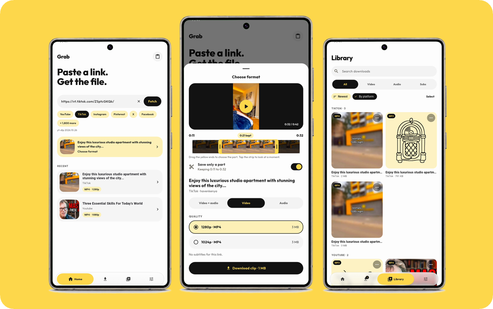
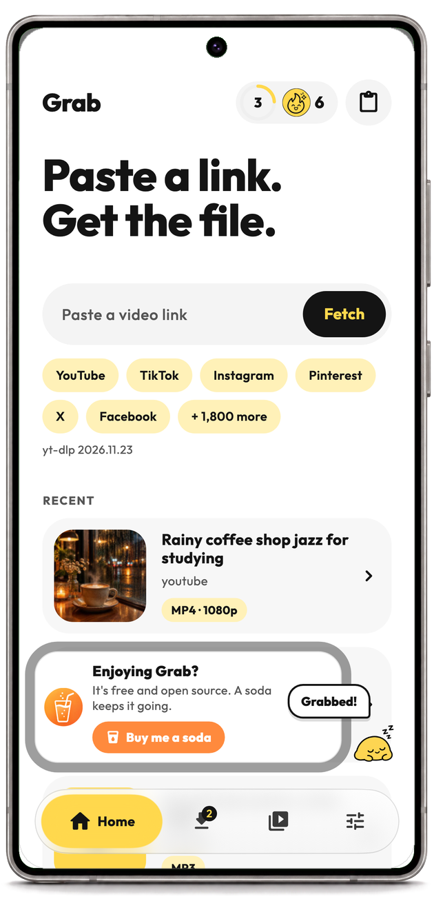
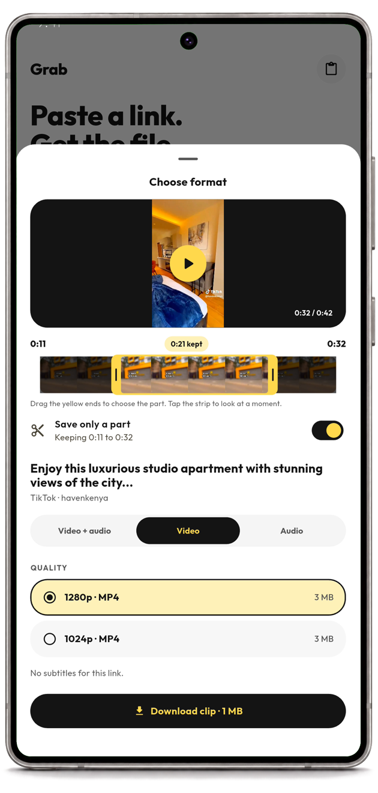
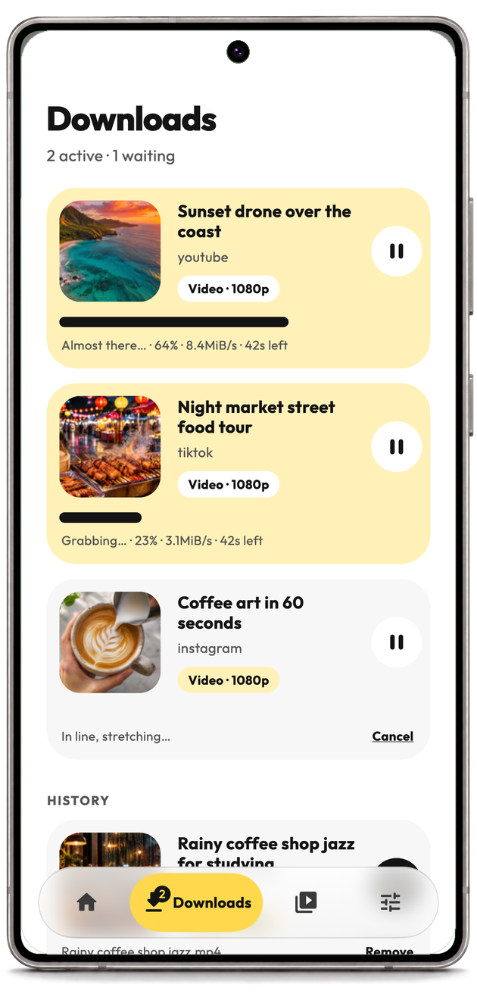
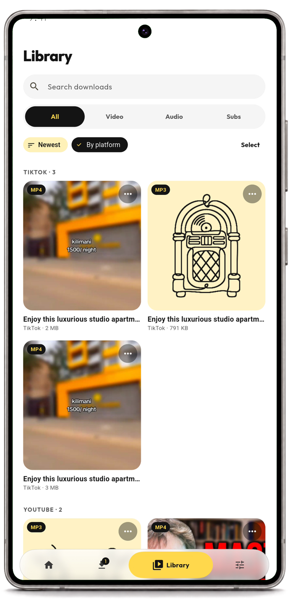
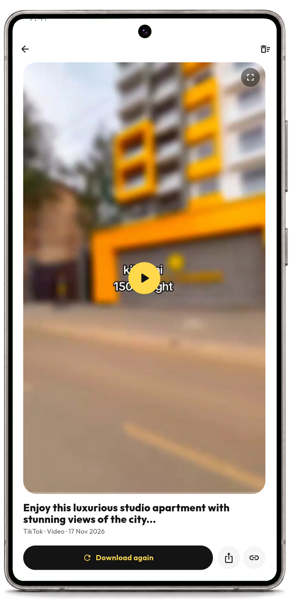
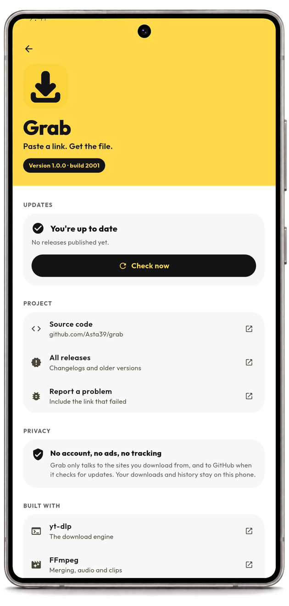

<div align="center">


# Grab

**Paste a link. Get the file.**

A free, open-source Android app for saving video, audio and subtitles from TikTok, YouTube, Instagram, Pinterest, X, Facebook and [1,800+ other sites](https://github.com/yt-dlp/yt-dlp/blob/master/supportedsites.md).

[](LICENSE)
[](#requirements)
[](https://flutter.dev)
[](https://github.com/yt-dlp/yt-dlp)

[Features](#features) · [Screenshots](#screenshots) · [Install](#install) · [Build from source](#build-from-source) · [Architecture](#architecture) · [Contributing](#contributing)

<br>



</div>

---

## Overview

Grab runs [yt-dlp](https://github.com/yt-dlp/yt-dlp) and [FFmpeg](https://ffmpeg.org) directly on the phone through [youtubedl-android](https://github.com/yausername/youtubedl-android). No server, no account, no ads and no tracking: links are fetched straight from the source site, and files are saved to `Download/Grab` (or a folder you choose) on your device.

## Features

### Downloading
- **Four modes**
  - **Video + audio:** the video with its sound, plus a separate extracted audio file
  - **Video:** the video with its sound
  - **Audio:** the soundtrack only
  - **Subs:** subtitles only
- **Formats and sizes up front:** pick a quality and see the file size before you download
- **Preview before you save:** play the video right in the format sheet
- **Save only a part:** a CapCut-style trim bar under the preview; drag the yellow ends and watch the exact frame you're cutting at
- **Playlists and profiles:** paste a playlist, channel or profile and pick which items to grab
- **Pause and resume:** stop a download and carry on later from where it left off
- **Survives bad connections:** downloads that drop wait for the network and retry by themselves
- **Live progress:** percent, speed and time left, in the app and in the notification
- **Subtitles:** saved as `.srt`, embedded in the video, or on their own
- **Share to Grab, or copy and tap:** share a link from any app, use the Quick Settings tile, or let Grab offer the link you just copied (never the same video twice)

### Library
- **Sort and group:** newest, oldest, largest or by site, and grouped by platform
- **Pick several files** to share or delete together
- **A page for each download:** preview, every file it produced, play, share, delete or download again
- **Extract audio later** from a saved video, without fetching the link again
- **Background audio player** with lock-screen controls and a mini player
- **Ringtone maker:** cut up to 40 seconds of any file and set it as your ringtone
- **Line-art covers** for audio files, 50 illustrations that never repeat back to back

### Experience
- **Pop design:** bold yellow and ink colours, pill shapes, light and dark themes
- **Frosted glass dock** with a gooey selection blob that stretches between tabs
- **Cards that grow into pages:** tapping a download morphs it into its own page
- **iOS-style haptics:** crisp taps from Android haptic primitives, with success and error patterns
- **Fits any screen:** the layout scales to your screen size and Display size setting
- **Permissions explained first:** a short welcome tells you why before Android asks

### Settings
- Default mode and quality, video container (MP4, MKV, WEBM) and audio format (MP3, M4A, Opus, FLAC)
- **Save folder:** Download, Movies or Music, with your own folder name
- **File names:** a template such as `{title} - {site}`
- **Storage:** how much space downloads use, and clearing failed ones
- **Always-current engine:** yt-dlp updates itself daily, so site changes don't need a new app release
- **In-app updates:** Grab checks GitHub releases and installs new versions over the old one, keeping everything

## Screenshots

<table>
  <tr>
    <td align="center"><br><b>Paste a link</b><br><sub>Or tap Grab it on a copied link</sub></td>
    <td align="center"><br><b>Preview and trim</b><br><sub>See exactly what you keep</sub></td>
    <td align="center"><br><b>Live progress</b><br><sub>Percent, speed, time left; pause any time</sub></td>
  </tr>
  <tr>
    <td align="center"><br><b>Library</b><br><sub>Sorted, grouped, with line-art covers</sub></td>
    <td align="center"><br><b>Every download, its own page</b><br><sub>Play, share, extract audio, ringtone</sub></td>
    <td align="center"><br><b>About and updates</b><br><sub>New versions install over the old one</sub></td>
  </tr>
</table>

## Install

Prebuilt APKs will be published on [Releases](https://github.com/Asta39/grab/releases) and F-Droid. Until then, [build from source](#build-from-source). Most phones need the `arm64-v8a` build.

### Requirements
- Android 7.0 (API 24) or newer
- Enough free space for the app (~70 MB download) plus its bundled Python and FFmpeg

## Build from source

**Prerequisites:** Flutter 3.44+, Android SDK with platform 37, JDK 17.

```bash
git clone https://github.com/Asta39/grab.git
cd grab
flutter pub get
dart run build_runner build
flutter build apk --release --split-per-abi
```

APKs are written to `build/app/outputs/flutter-apk/`.

> [!NOTE]
> Code shrinking (`minify`/`shrinkResources`) is disabled on purpose, because it breaks youtubedl-android's native loading.

### Release signing

Create `android/key.properties` (git-ignored):

```properties
storeFile=/absolute/path/to/grab-release.jks
storePassword=…
keyAlias=grab
keyPassword=…
```

Without this file, release builds fall back to the debug key.

## Architecture

```
lib/
├── app/            App shell, routing, providers
├── core/           Theme (Pop), shared widgets, audio player, updates, haptics, scaling
├── data/
│   ├── db/         drift database and migrations
│   ├── engine/     Dart side of the download engine
│   ├── repositories/  Download queue and history
│   └── settings/   Preferences
└── features/       Welcome, Home, Downloads, Library, Detail, Settings
android/app/src/main/kotlin/app/grab/grab/
├── EnginePlugin.kt      yt-dlp and FFmpeg bridge (method and event channels)
├── DownloadService.kt   Foreground service and notifications
├── HapticsPlugin.kt     Haptic primitives
├── RingtonePlugin.kt    Ringtone cutting and setting
├── AppPlugin.kt         In-app updates and links
└── GrabTileService.kt   Quick Settings tile
```

| Concern | Choice |
| --- | --- |
| State | [Riverpod 3](https://riverpod.dev) |
| Storage | [drift](https://drift.simonbinder.eu) (SQLite), shared_preferences |
| Engine | [youtubedl-android](https://github.com/yausername/youtubedl-android) (yt-dlp and FFmpeg) |
| UI | flutter_animate, animations, toastification, confetti |
| Platform | receive_sharing_intent, permission_handler, share_plus, video_player, just_audio, connectivity_plus |

## Testing

```bash
flutter analyze
flutter test
```

## Contributing

Issues and pull requests are welcome. Please read the [contributing guide](CONTRIBUTING.md) and follow the [code of conduct](CODE_OF_CONDUCT.md). Found a security problem? See the [security policy](SECURITY.md) and report it privately.

## Acknowledgements

Grab stands on the work of [yt-dlp](https://github.com/yt-dlp/yt-dlp), [FFmpeg](https://ffmpeg.org), [youtubedl-android](https://github.com/yausername/youtubedl-android), and apps such as [Seal](https://github.com/JunkFood02/Seal) that showed what a great Android downloader can be.

## License

Grab is licensed under the [GNU General Public License v3.0](LICENSE).

> [!IMPORTANT]
> Download only content you have the right to save, and follow each site's terms of service. Grab is not affiliated with any of the sites it supports.
